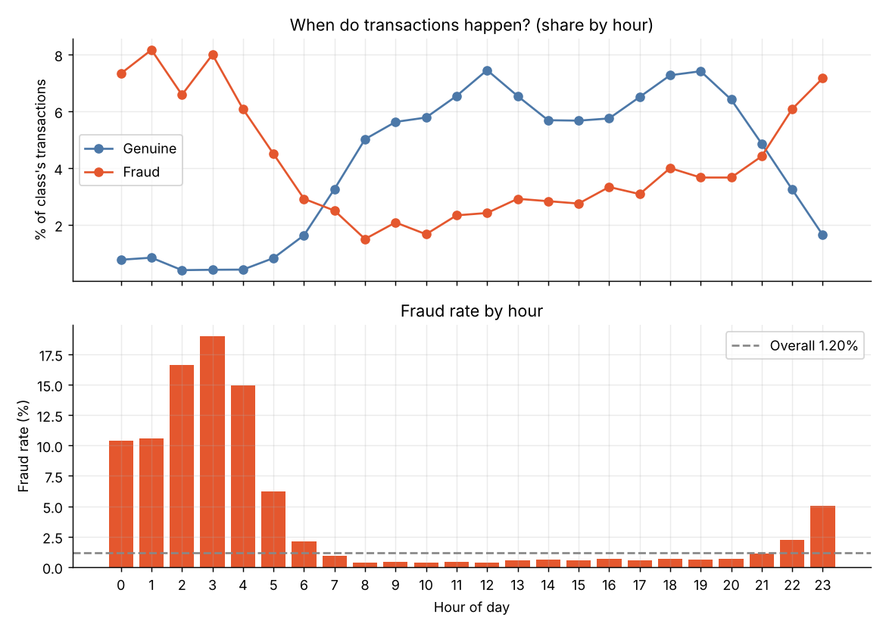
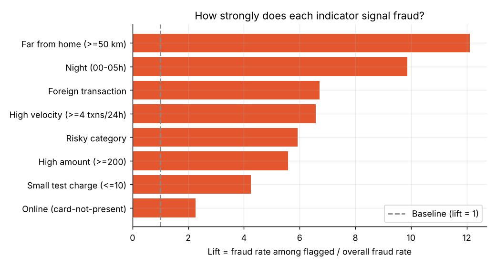
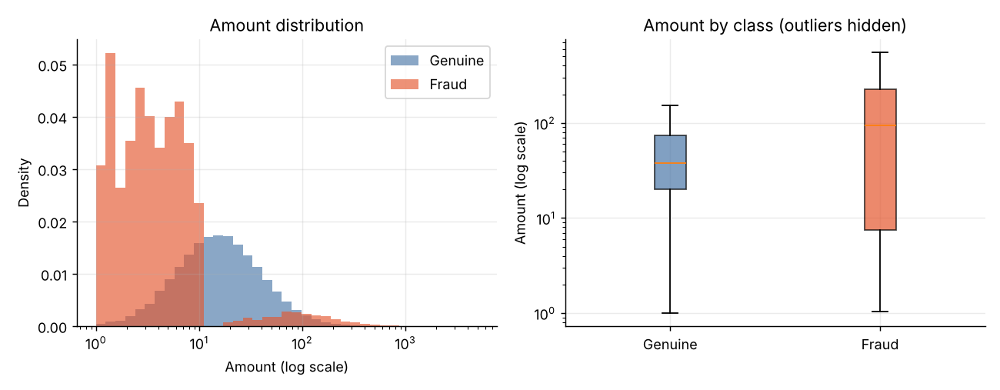
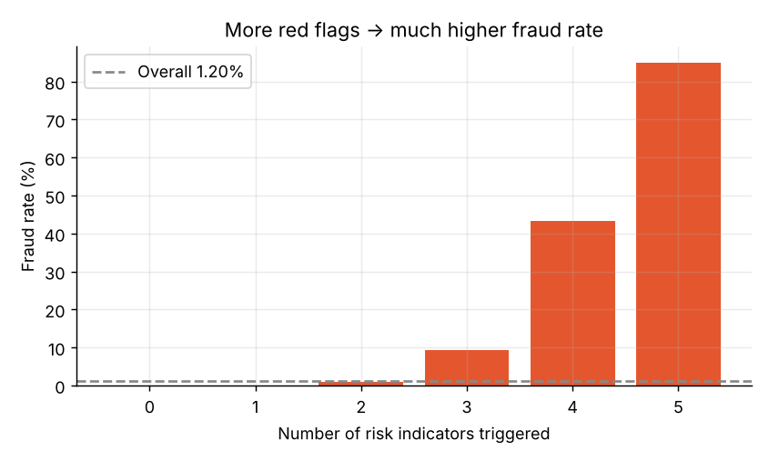

# Credit Card Fraud Pattern Analysis

An analytical (non-ML) study of credit card transactions: how fraud differs from genuine
activity in **amount, time and behaviour**, and which simple patterns best flag suspicious
transactions.

> **No machine-learning model is trained.** Everything is descriptive statistics,
> hypothesis tests and transparent rule-based indicators.

## Objectives

1. How many transactions are genuine vs fraudulent?
2. What percentage is fraud?
3. How does fraud amount differ from genuine amount?
4. In which time periods does fraud peak?
5. What other pattern differences exist (category, channel, location, velocity)?
6. Which patterns are most useful to identify suspicious transactions?

## Dataset

| | |
|---|---|
| **Default** | `data/transactions.csv` - **synthetic**, 100,000 transactions over 30 days, 1.2% fraud, generated by `generate_dataset.py` (seed 42, fully reproducible) |
| **Optional real data** | [Credit Card Fraud Detection - Zenodo 7395559](https://zenodo.org/records/7395559) (CC BY 4.0): 284,807 European card transactions, 492 frauds (0.172%) |

**Why synthetic by default?** The synthetic data has readable columns (category, channel,
distance, velocity), which makes the pattern analysis meaningful. Its fraud rate (1.2%) is
higher than the real world (~0.1-0.2%) so every pattern has enough fraud samples. All
findings on this data illustrate the *method*; they are not claims about real cardholders.

**Columns:** `transaction_id, timestamp, customer_id, amount, merchant_category, channel,
is_foreign, distance_from_home_km, txn_count_24h, is_fraud`

### Running on the real Zenodo dataset

```bash
# download creditcard.csv from https://zenodo.org/records/7395559 into data/
python analysis.py --data data/creditcard.csv --out outputs_creditcard
```

The real file only exposes `Time`, `Amount`, `Class` (other columns are anonymised PCA
features), so only class balance, amount and time-of-day sections run on it.

## Project structure

```
.
├── data/transactions.csv      # synthetic dataset
├── generate_dataset.py        # builds the dataset (reproducible)
├── analysis.py                # full analysis -> figures, tables, findings
├── outputs/
│   ├── figures/               # 10 charts (PNG)
│   ├── tables/                # 13 summary tables (CSV)
│   └── findings.md            # auto-generated key numbers
├── requirements.txt
└── LICENSE
```

## How to run

```bash
pip install -r requirements.txt
python generate_dataset.py     # optional: recreate data/transactions.csv
python analysis.py             # regenerates everything in outputs/
```

## Key findings (synthetic dataset)

Full numbers: [`outputs/findings.md`](outputs/findings.md)

| Question | Result |
|---|---|
| Genuine vs fraud | 98,800 genuine, **1,200 fraud (1.20%)** - about 1 in 83 |
| Amount | Median fraud **94.35** vs genuine **37.98**; fraud is bimodal: many tiny "card-testing" charges (35% are <= 10) plus large purchases |
| Time | **40.7%** of fraud happens 00-05h vs 3.7% of genuine; fraud rate at night **11.8%** vs **0.74%** by day; peak at 03:00 (19%) |
| Burst day | 2024-01-12 had 106 frauds vs a daily average of 40 |
| Category | Jewelry, gift cards and electronics are riskiest (jewelry 12.8% fraud rate) |
| Channel / location | Online fraud rate 2.7% vs in-store 0.37%; foreign 8.1% vs domestic 1.0% |
| Behaviour | Fraud occurs far from home (median 54 km vs 4.7 km) and in bursts (avg 4 txns in 24h vs 2) |

### Which patterns flag suspicious transactions best?

Single indicators are weak alone; **combining** them is powerful. Flagging transactions that
trigger **>= 4 of 8** simple rules reviews only **1.2%** of traffic yet catches **60%** of fraud
at **59% precision** (49x better than random).

| Figure | |
|---|---|
|  |  |
|  |  |

## Methods

- Descriptive statistics by class, amount bands, hourly / daily profiles
- Mann-Whitney U test (amount difference), chi-square test (category vs fraud)
- Rule-based indicators evaluated with **precision, recall and lift** (fraud rate among
  flagged / overall fraud rate)

## Limitations

- Synthetic data: patterns were designed into it, so effect sizes are cleaner than reality.
- Rules were evaluated on the same data used to design thresholds (no hold-out) - fine for
  an exploratory study, not for production claims.
- Real fraud is far rarer and adversaries adapt; static rules decay over time.

## Tech

Python, pandas, NumPy, SciPy, Matplotlib.

## License

MIT (code). If you use the Zenodo dataset, credit its creator under CC BY 4.0.
